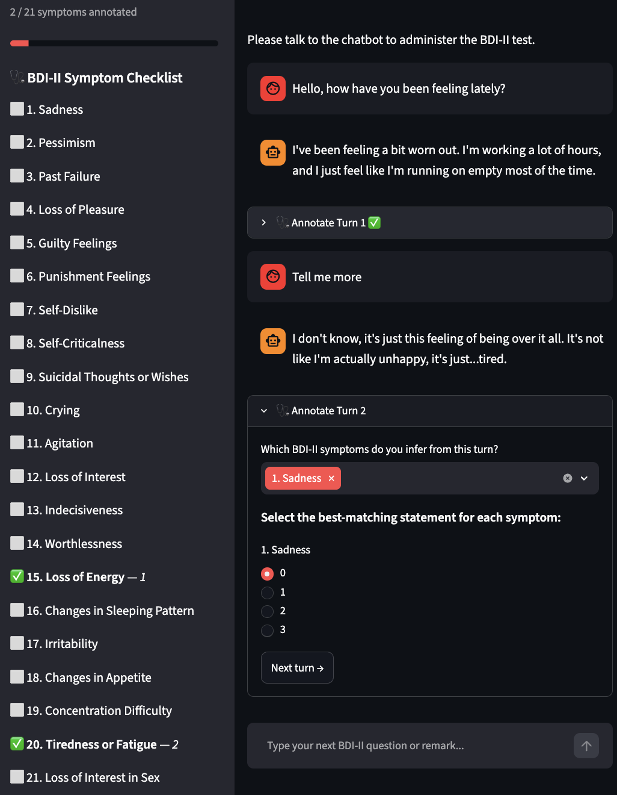

# BDIChat: A Conversational Depression Detection Dataset using Beck’s Depression Inventory-II

Depression often goes undiagnosed because access to mental health professionals is limited. Conversational agents could offer an accessible first step for screening, but building them requires dialogue data that links individual utterances to clinically relevant symptoms and their severity. Existing depression datasets are mostly static posts or carry only an overall diagnostic label, so they cannot support turn-level symptom inference or severity assessment.

**BDIChat** fills this gap. It contains 100 multi-turn interviews between 20 simulated patient personas (from the Early Risk Prediction on the Internet Lab, eRisk) and 51 real mental health professionals. The professionals ask the persona about their symptoms in order to fill in the Beck Depression Inventory-II (BDI-II) on their behalf. After each turn they mark which BDI-II symptoms the exchange revealed and score how severe each one is, given the context of the conversation.

BDIChat is, to our knowledge, the first English dataset that combines multi-turn dialogue, expert annotation with a clinical instrument, turn-level multi-label symptom annotation, and symptom-level severity scores.

## Summary

| | |
|---|---|
| **Conversations** | 100 (5 experts per persona) |
| **Turns** | 2,332 (23.3 ± 11.9 per conversation) |
| **Personas** | 20 simulated eRisk 2026 patients, covering minimal, mild, moderate and severe depression |
| **Experts** | 51 mental health professionals (psychologists, clinical psychologists, psychiatrists) recruited on Prolific |
| **Instrument** | Beck Depression Inventory-II (21 symptoms, each scored 0–3) |
| **Language** | English |

## What Is Annotated?

- **Symptom relevance.** For each turn (one expert message plus one persona reply), the expert selects which BDI-II items the turn informs. A turn can have several symptoms or none. About 81% of turns have at least one symptom flagged.
- **Symptom severity.** Each flagged symptom gets a score from 0 (absent) to 3 (most severe). Experts could revise scores as the conversation went on, and did so for 22.5% of items.
- **Consensus scores.** For each persona, the item scores from the five experts are averaged into one consensus score per BDI-II item, giving a total score and severity category (minimal 0–13, mild 14–19, moderate 20–28, severe 29–63).

## Data Collection

**Personas.** We used the 20 LLM personas from eRisk 2026 Task 1 (conversational depression detection). Each is a LoRA adapter on Meta-Llama-3-8B-Instruct, fine-tuned on user histories of a different BDI-II severity, so together they cover minimal, mild, moderate and severe depression. The personas are not based on, and do not mimic, any real individual.

**Experts.** We recruited 51 mental health professionals on [Prolific](https://www.prolific.com), which verifies domain expertise through skills assessments, credential review and work-experience validation. 64.7% were psychologists, 25.5% clinical psychologists and 9.8% psychiatrists. All reported fluency in English. For each persona we hired five different experts, giving 100 conversations. Each expert interviewed between one and five personas.

**Interview and annotation.** Experts chatted with the persona on a platform hosted on Hugging Face Spaces and were asked to interview it as they would a real patient. A turn is one expert message plus one persona reply. After each turn, the expert could select any number of BDI-II items (or none) that the turn revealed and score them from 0 to 3. A side panel tracked which items had been scored so far. Once every item was scored, the expert could submit or keep talking to revise scores they were unsure about. The full instructions are in [`assets/`](assets).

<p align="center">
  
</p>
*The chat screen shown to the experts while they interviewed a persona and annotated each turn.*

**Consensus scores.** Because each expert held a different conversation, the five final item scores per persona were averaged into a single consensus score per item. We chose averaging on the advice of a graduate student specialising in psychology. These scores are in `data/bdichat_consensus_scores.csv`.

**Participation and anonymity.** Experts were told the purpose of the study, what data would be stored, that the patients are simulated, and that they could withdraw at any time. They gave informed consent and were paid well above average. We replaced Prolific IDs with our own indices and release no demographic data.

## Tasks and Baselines

We provide baselines for two tasks. Fine-tuned encoders outperform zero-shot GPT-4o-mini on both.

**Symptom Relevance Detection** (multi-label, micro-averaged)

| Model | P | R | F1 |
|---|---|---|---|
| GPT-4o-mini (item descriptions) | 0.435 | 0.492 | 0.462 |
| SBERT, fine-tuned | 0.519 | 0.493 | 0.506 |
| MentalBERT, fine-tuned | **0.531** | **0.534** | **0.532** |

**Symptom Severity Detection** (4-class ordinal, 0–3)

| Model | Accuracy | MAE | QWK |
|---|---|---|---|
| GPT-4o-mini (zero-shot) | 0.450 | 0.727 | 0.430 |
| SBERT, fine-tuned | 0.543 | 0.596 | 0.601 |
| MentalBERT, fine-tuned | **0.575** | **0.510** | **0.638** |

Other uses include predicting the overall BDI-II score (from the full dialogue or incrementally), building full relevance-plus-severity pipelines, training interviewer models that ask about uncovered symptoms, and checking how consistent LLM personas are across interviewers.

## Repository Contents

| Path | Description |
|---|---|
| `data/all-persona-chats/` | One JSON file per interview (100 files), named `p{persona_id}_c{clinician_id}.json`. Full conversation plus turn annotations. |
| `data/bdichat_turn_annotations.csv` | Turn-level table: 2,332 rows, one per turn, with the expert message, persona reply, symptom flags and scores. |
| `data/bdichat_persona_clinician_symptom.csv` | Final BDI-II item scores, total and severity category given by each expert for each persona (100 rows). |
| `data/bdichat_consensus_scores.csv` | Consensus item scores, total and severity category per persona (20 rows). |
| `experiments/` | Implementation for the two tasks introduced in the paper. |
| `assets/` | Annotation guidelines given to the experts (PDF) and the screenshot of the annotation interface. |

## Data Format

### Conversation Files (`data/all-persona-chats/`)

Each file is one interview:

```json
{
  "session_id": "457eb403-3120-48d8-8d95-e7699d789d04",
  "persona_id": 0,
  "clinician_id": 2,
  "start_time": "2026-06-22T13:19:13.111385",
  "end_time": "2026-06-22T13:53:13.570781",
  "messages": [
    {"role": "system", "content": "You are a simulated patient. ..."},
    {"role": "user", "content": "<expert message>"},
    {"role": "assistant", "content": "<persona reply>"}
  ],
  "turn_annotations": [
    {
      "turn": 1,
      "symptoms": ["20. Tiredness or Fatigue"],
      "scores": {"20. Tiredness or Fatigue": {"label": "2", "score": "2"}},
      "annotated_at": "2026-06-22T13:20:50.620599"
    }
  ]
}
```

- `messages` follows the chat format. The `system` message is the persona instruction, `user` is the expert and `assistant` is the simulated patient. Turn *n* is the *n*-th `user` message and the `assistant` reply after it.
- `turn_annotations` lists the symptoms the expert flagged for a turn and the score they gave each one. Turns with no flagged symptom have an empty `symptoms` list.

### Turn-level Table (`bdichat_turn_annotations.csv`)

| Column | Meaning |
|---|---|
| `persona_id`, `clinician_id`, `turn` | Identify the session and turn |
| `Message`, `PersonaReply` | Expert message and persona reply |
| `1. Sadness` … `21. Loss of Interest in Sex` | 1 if the expert flagged this BDI-II item as relevant to the turn, otherwise 0 |
| `1.Score` … `21.Score` | Severity score (0–3) the expert gave the item at this turn, or `-1` if the item was not flagged |

### Session and Persona Tables

`bdichat_persona_clinician_symptom.csv` has `personaId`, `clinicianId`, the 21 item scores, `BDI Total` and `Severity`. `bdichat_consensus_scores.csv` has the same columns per `personaId`, where item scores are the consensus across the five experts.

### Loading The Data

```python
import pandas as pd

turns = pd.read_csv("data/bdichat_turn_annotations.csv")
consensus = pd.read_csv("data/bdichat_consensus_scores.csv")

symptom_cols = [c for c in turns.columns if c[:2].strip(". ").isdigit() and not c.endswith("Score")]
turns["n_symptoms"] = turns[symptom_cols].sum(axis=1)
```

## Limitations

- **Simulated patients.** Personas are LLMs, so their replies may depend on how a question is phrased and may not reflect how real patients express symptoms.
- **Different conversations per expert.** No two experts had the same conversation with a persona. Item-level agreement is low (mean Krippendorff’s α = 0.223; total-score α = 0.468), which reflects both clinical disagreement and different information elicited.
- **Scope.** 20 personas, English only, BDI-II only. The annotator pool was predominantly female and white.

## Ethical Considerations

All patient utterances were generated by simulated LLM personas that are not based on or imitative of any real individual. The participants were mental health professionals who were informed of the study purpose, the data collected and stored, confidentiality arrangements, possible distressing topics, and their right to withdraw at any time, and provided informed consent before participation. They were compensated well above average. No personally identifying or demographic information is included in BDIChat. 

BDIChat is intended for research on conversational depression screening. **It is not a diagnostic tool and not a substitute for professional mental health care.**

## Citation

Coming soon..

## Authors

Isin Su Ecevit, Ana-Maria Bucur and Fabio Crestani, Università della Svizzera italiana (USI), Lugano, Switzerland.

## License

MIT
